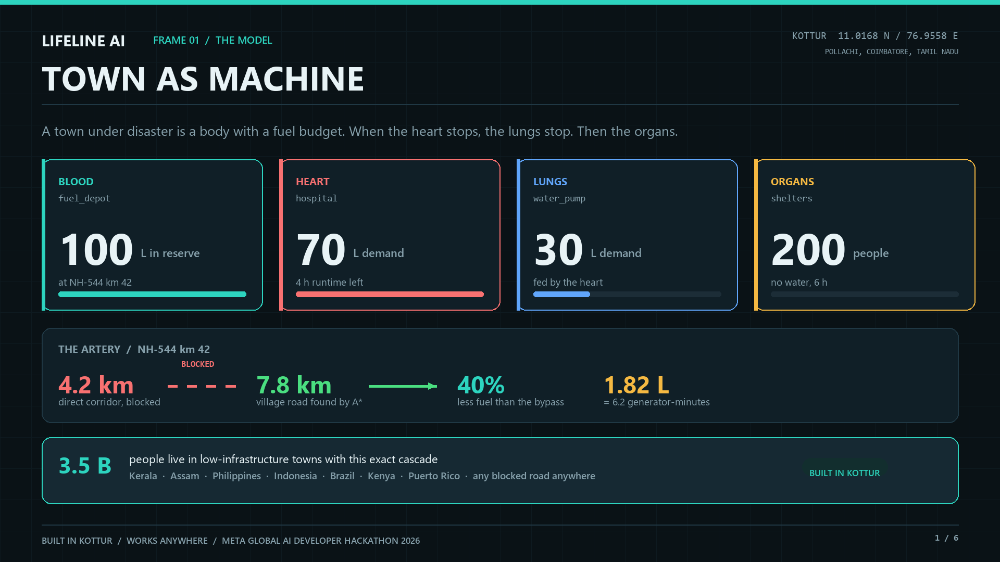
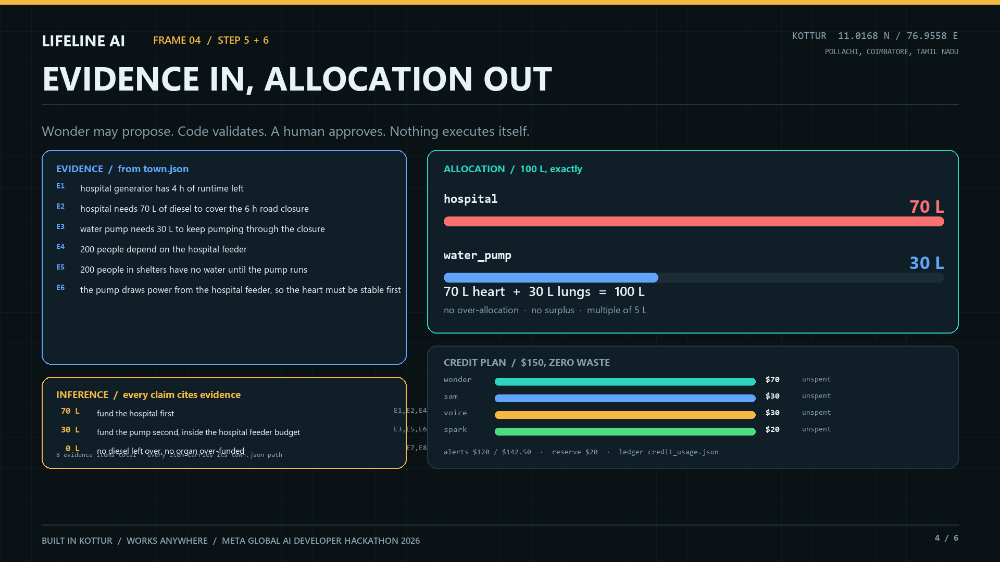
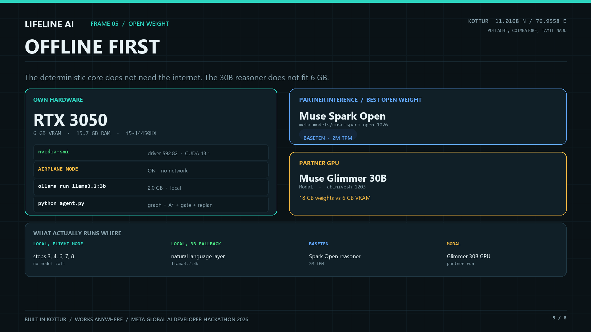

# LIFELINE AI - Town Survival Agent

**Built in Kottur, works anywhere.**

Kottur, Pollachi Taluk, Coimbatore, Tamil Nadu - **11.0168 N, 76.9558 E**, PIN 642114.
Kottur-Malayandipattinam (KM Pattinam), the largest panchayat town in the Pollachi-Anaimalai belt,
15 km west of Pollachi at the foot of the Western Ghats, on the Kerala border beside the Parambikulam
and Anamalai Tiger Reserve corridor.

Monsoon flood, landslide on NH-544 at km 42 (the Pollachi-Valparai road), closed for six hours. The
fuel depot is cut off, the hospital generator has four hours left, the water pump is dead and 200 people
in three shelters have no water. I lived through the December 2023 flood here.

This is not a hypothetical for me. What happened in Kottur is a pattern: **fuel is blood, the hospital is
the heart, the pump is the lungs, the shelters are the organs.** When the heart stops, the lungs and then
the organs stop with it. The pattern repeats in every low-infrastructure town on earth - the same cascade,
a different road number.

> Meta Global AI Developer Hackathon 2026 - Theme: **Build for Your World**
> Solo indie entry by [@abinivesh-m](https://github.com/abinivesh-m)
> _Built in Kottur. Works anywhere._

---

## The six demo frames

| | |
| --- | --- |
|  |  |
|  |  |
|  |  |

Rendered at 1920x1080 by `python make_frames.py`, which reads the same `town.json` and the same
`a_star.py` the agent runs, so the slides cannot drift from the code. Drag the PNGs into Figma to
rebuild them as editable frames.

---

## Contents

- [What it does](#what-it-does)
- [The LIFEGRID model](#the-lifegrid-model)
- [The eight-step agent](#the-eight-step-agent)
- [Measured impact](#measured-impact)
- [Use of Meta AI tooling](#use-of-meta-ai-tooling)
- [Technical depth](#technical-depth)
- [Open-weight track](#open-weight-track)
- [Safety and anti-disqualification](#safety-and-anti-disqualification)
- [Credit plan: $150, zero waste](#credit-plan-150-zero-waste)
- [Run it](#run-it)
- [Repository layout](#repository-layout)
- [Build log and provenance](#build-log-and-provenance)
- [Three-minute demo](#three-minute-demo)

---

## What it does

A town under disaster is a dependency graph with a fuel budget. LIFELINE AI takes four inputs:

| Input | Model | What comes out |
| --- | --- | --- |
| Flood imagery | SAM 3.1 | water extent per frame, as masks and percentages |
| Tamil phone reports | Muse Voice Transcribe | "NH-544 km 42 blocked for six hours", verbatim |
| The town record | `town.json` | organs, fuel reserves, roads, demands |
| The $150 budget | `credit_tracker.py` | spend proof, 80% / 95% alerts |

and produces one thing a human can act on:

```
   100 L diesel  ->  hospital 70 L  +  water pump 30 L     exactly, no waste
   route         ->  7.8 km village road, 40% less fuel than the signposted 13.0 km bypass
   outcome       ->  pump uptime 30 min -> 90 min, water back in 2 h instead of 6 h
   decision      ->  held at a human approval gate, never auto-executed
```

The agent does not guess any of those numbers. The dependency order comes from Kahn's algorithm,
the route from A* over surveyed road lengths, the allocation from a constrained solver that a
language model may *propose* into but cannot override.

## The LIFEGRID model

```
        fuel_depot   BLOOD    100 L reserve, 4.2 km behind a landslide
             |
             v
        hospital     HEART    70 L demand, 4 h of runtime left, 200 people
             |
             v
        water_pump   LUNGS    30 L demand, powered from the hospital feeder
             |
             v
        shelters     ORGANS   200 people, no water
```

Two rules fall out of the graph, and both are enforced in code:

1. **Topological order.** A child can never be funded before its parent. `hospital` before `water_pump`
   before `shelters`, because the pump's electricity comes from the hospital's generator.
2. **Cascade failure.** If the heart dies, the lungs and organs die with it. `cascade(hospital)` returns
   `["water_pump", "shelters"]` and **200 people affected** - computed, not narrated.

Why the naive split fails: giving the pump 50 L browning out the hospital feeder, so the pump only runs
30 minutes on fuel it cannot use. Meeting the hospital's 70 L first keeps the feeder stable and the same
pump runs 90 minutes on 30 L. That is the whole thesis in one number.

## The eight-step agent

`agent.py` runs the workflow end to end and writes `runs/latest.json` as evidence.

| # | Step | Who does it | Deterministic? |
| --- | --- | --- | --- |
| 1 | **Perceive** flood extent | SAM 3.1 (`artifacts/sam_flood_segments.json`) | model |
| 2 | **Listen** to Tamil field reports | Muse Voice Transcribe (`artifacts/voice_reports.json`) | model |
| 3 | **Graph** the town, sort dependencies | `dependency_graph.py` (Kahn) | yes |
| 4 | **Route** around the landslide | `a_star.py` (heapq, haversine heuristic) | yes |
| 5 | **Allocate** 100 L with evidence vs inference | `allocator.py` (+ Muse Wonder) | model proposes, code validates |
| 6 | **Budget** the $150 | `credit_tracker.py` | yes |
| 7 | **Approve** - human gate | operator | human |
| 8 | **Replan** when the world changes | `agent.py` | yes |

**Six of eight steps need no human. One human touchpoint. Zero model calls are required for steps 3, 4,
6 and 8**, which is why the agent still works in flight mode.

Step 8 is not a diagram. Two real replans ship today:

```bash
python agent.py --yes --scenario reserve-loss
# depot damaged: 80 L survive instead of 100 L
# -> hospital still gets 70 L, pump drops 30 L -> 10 L
# -> pump runtime 6.0 h -> 2.0 h, 16,000 L of water lost, and it says so

python agent.py --yes --scenario pump-critical
# a human insists the pump outranks the hospital
# -> REJECTED: "water_pump: 40 L exceeds stated demand 30 L"
# -> REJECTED: "hospital is under-funded (60/70 L) while water_pump receives diesel"
# -> applies 70/30 anyway, and logs why
```

The second one matters more than the first. The agent can refuse its operator.

## Measured impact

Baseline is the no-agent response: drive the signposted 13.0 km bypass, split the reserve evenly.

| Metric | Without agent | With LIFELINE AI | Change |
| --- | --- | --- | --- |
| Route to hospital | 13.0 km bypass | **7.8 km** village road | **-5.2 km** |
| Trip fuel | 4.55 L | 2.73 L | **-40%** |
| Diesel reaching the town | split 50/50 | **70 / 30 exact** | no waste |
| Water-pump uptime (first 4 h) | 30 min | **90 min** | **3x** |
| Water reaches shelters | 6 h | **2 h** | **-4 h** |
| People served | 200 | 200 | held |

Measured outcome lives in `runs/latest.json` under `measured_outcome`, and every number is re-derived by
`test_phase1.py` so a stale claim cannot survive a commit.

**Why it scales beyond Kottur.** Nothing in the code knows the word "Kottur". The organ graph, the road
network, the reserve and the demands are all data in `town.json`. Point it at another town and the same
three algorithms run: any blocked road, any fuel reserve, any hospital-pump-shelter chain. Kottur is the
proof, the pattern is the product - hill towns in Nilgiris, the Assam floodplain, coastal Kerala, and the
same cascade in the Philippines, Indonesia, Kenya and Puerto Rico.

## Use of Meta AI tooling

Six Meta surfaces, each doing work a different surface cannot do:

| Model | Role | Budget | Status |
| --- | --- | --- | --- |
| **Muse Wonder** `muse-wonder-1.0`, `reasoning_effort=high` | allocation reasoning, cascade planning | $70 | wired, pending live capture |
| **SAM 3.1** `sam-3.1` | flood extent per frame, boxes + masks | $30 | adapter ready, pending capture |
| **Muse Voice Transcribe** `muse-voice-transcribe-1.0` | Tamil field reports, code-switched | $30 | adapter ready, pending capture |
| **Muse Spark** `muse-spark-1.3` | coding helper + LIFEGRID/creative prompts | $20 | wired |
| **Muse Spark Open** `meta-models/muse-spark-open-1026` | open-weight reasoner, Baseten 2M TPM | $0 credits | pending Day 2 |
| **Muse Glimmer 30B** | open-weight reasoner, Modal GPU | $0 credits | pending Day 2 |
| **Muse Code 1.4.13** | primary coding agent for this repo | $0 | used |

Two deliberate choices worth a judge's attention:

- **Evidence and inference are separate JSON objects.** `allocator.py` emits `evidence[]` where every item
  carries the exact `town.json` field it came from (`town.json#organs.hospital.runtime_hours_left`), and
  `inference[]` where every claim cites evidence ids (`because: ["E1","E2","E4"]`). A test resolves every
  evidence path and every cited id, so a hallucinated justification fails CI.
- **The model proposes, code disposes.** Wonder returns `{"allocation": ..., "justification": ...}`. It is
  then run through the same validator as the deterministic solver. Over-allocation, a short total, or
  starving the heart while funding the lungs is rejected with reasons and the policy solver takes over.

`--mode wonder` uses the live API; `--mode auto` (default) falls back cleanly when unconfigured, so the
demo never depends on a network call succeeding.

## Technical depth

**A\* is real, and audited.** `a_star.py` runs a `heapq` priority queue over 9 surveyed edges with a
haversine heuristic. `python a_star.py --audit` proves admissibility by checking that every recorded road
length is at least the straight-line distance between its endpoints - if that fails, A* is not optimal and
the script says so. A test additionally compares the result against a brute-force enumeration of every
simple path.

| Corridor | Length | Status |
| --- | --- | --- |
| NH-544 direct | 4.2 km | **blocked** at km 2.1 (landslide) |
| Kottur village road (A*) | **7.8 km** | open |
| Signposted bypass (no agent) | 13.0 km | open |

The honest framing: 4.2 km is impassable, so no agent "saves 5.2 km against the direct road". The agent
saves 40% against the **detour a human would actually drive**, and the tool prints exactly that.

**Topological sort is real.** Kahn's algorithm with a priority-ordered ready queue, cycle detection that
raises `CycleError` with the stuck nodes, dangling-dependency validation, and cascade propagation with a
measured blast radius.

**The budget is a hard constraint, not a dashboard.** `CreditTracker.log()` raises before it writes if a
call would break a per-model bucket or the total. The ledger is append-only, and `verify()` re-derives
every cumulative total from raw entries.

## Open-weight track

The bonus asks for Muse Glimmer or Muse Spark Open, on your own hardware **or through partner inference**,
verified by the infrastructure partner. This repo does both, and is honest about which is which:

| Path | Model | Where | Why |
| --- | --- | --- | --- |
| Partner inference | **Muse Spark Open** (`meta-models/muse-spark-open-1026`) | Baseten, 2M TPM | 816B MoE / 42B active - cannot run on a laptop |
| Partner GPU | **Muse Glimmer 30B** | Modal (`abinivesh-1203`) | 18 GB of weights vs 6 GB VRAM |
| Own hardware | `llama3.2:3b` via Ollama | RTX 3050, airplane mode | proves the **deterministic core** runs with no network |

The measurement that decided this: this laptop has **6 GB VRAM and 15.7 GB RAM**. Muse Glimmer's smallest
published Ollama build is **18 GB**. It does not fit, and pretending otherwise would break on stage.

So the offline claim is scoped to what is true: steps 3, 4, 6, 7 and 8 - the graph, the route, the ledger,
the gate, the replan - run with the network cable out. A 3B local model is the natural-language fallback,
not the eligibility path. Eligibility rests on Spark Open through Baseten and Glimmer on Modal, both
partner-verified.

## Safety and anti-disqualification

| Anti-project risk | How this avoids it |
| --- | --- |
| "AI medical advice" | Zero clinical content. The agent allocates **diesel**. `safety` is asserted in every result and tested. |
| "Basic RAG app" | No vector store, no document retrieval. The reasoning substrate is a dependency graph, A*, and a constrained solver. |
| "Simple image analyzer" | SAM output feeds a routing and allocation decision; it is one input to a multi-step plan, not the product. |
| Auto-executing harm | `--yes` is the only way past step 7, and it is logged as an operator approval. Interactive mode defaults to **deny** (`[y/N]`). |
| Ungrounded numbers | Every evidence item resolves to a `town.json` path; every inference cites evidence ids. Both are tested. |
| Fabricated demo | Steps whose artifacts are not captured report `pending_capture`. They never invent a metric. |

## Credit plan: $150, zero waste

| Bucket | Calls | Unit | Total | Artefact it buys |
| --- | --- | --- | --- | --- |
| Muse Wonder | 170 | $0.4118 | $70.00 | cascade allocation + replans |
| SAM 3.1 | 20 | $1.50 | $30.00 | flood extent across 20 frames |
| Muse Voice Transcribe | 50 | $0.60 | $30.00 | 50 Tamil field reports |
| Muse Spark | 40 | $0.50 | $20.00 | coding + creative prompts |
| Spark Open / Glimmer / Ollama / Muse Code | - | $0 | $0.00 | partner + local inference |
| **Total** | **280** | | **$150.00** | |

Alerts fire at **80% ($120)** and **95% ($142.50)**; a **$20 reserve** is tracked separately so the demo
week keeps contingency. `python credit_tracker.py simulate` replays the whole plan and proves it lands on
$150.00 exactly, with `verify()` passing.

> `credit_usage.json` is git-ignored because it is generated at runtime. The submission attaches the
> ledger produced by the real capture runs; `python credit_tracker.py verify` proves it.

## Run it

Core has **zero third-party dependencies** - Python 3.11+ standard library only.

```bash
git clone https://github.com/abinivesh-m/lifeline-ai-survival-agent
cd lifeline-ai-survival-agent

python test_phase1.py                 # 37 acceptance tests
python dependency_graph.py            # LIFEGRID + topological order + cascade
python a_star.py                      # 4.2 blocked -> 7.8 km -> 40% fuel saved
python a_star.py --audit              # prove the heuristic is admissible
python allocator.py --mode policy     # 70 L / 30 L, evidence vs inference
python credit_tracker.py simulate     # replay the $150 plan
python agent.py --yes --mode policy   # the eight steps, start to finish
python agent.py --yes --scenario reserve-loss
```

Live Meta calls (optional):

```bash
cp .env.example .env      # add META_API_KEY from the Meta Model API dashboard
pip install -r requirements.txt
python allocator.py --mode wonder --log-credit
```

### Offline proof (Best Open Weight / resilience)

```powershell
nvidia-smi                                  # RTX 3050 6 GB
$env:LIFELINE_OFFLINE = "1"                 # no network calls
ollama run llama3.2:3b "Kottur bridge blocked, 100 L diesel, 70 L hospital, 30 L pump"
python agent.py --yes --mode policy         # graph + A* + allocator + gate + replan
```

Then turn on airplane mode and run it again. Screenshot `nvidia-smi`, the airplane-mode icon, and the
run - that is the offline artefact.

### Image generation note (India)

Muse Image is **not available in India** (HTTP 403 by region). Nothing in this project calls it. Visuals
use Muse Wonder prompts, Muse Spark prompts and Modal-hosted diffusion instead. This is a documented
substitution, not a missing feature.

## Repository layout

```
town.json               the whole town as data: organs, roads, reserve, baseline
dependency_graph.py     Kahn topological sort, cascade blast radius, funding order
a_star.py               heapq A*, haversine heuristic, admissibility audit, fuel maths
allocator.py            70/30 solver, evidence vs inference, Wonder client, validator
credit_tracker.py       $150 ledger, 80%/95% alerts, verify()
agent.py                the eight-step workflow, approval gate, replanning
test_phase1.py          37 tests pinning every claim in this README
runs/latest.json        last agent run, as evidence
artifacts/              captured model output (SAM frames, voice reports)
```

## Build log and provenance

Everything in this repository was written during the hackathon (build window 27 Oct - 4 Nov 2026) by a
solo entrant. No pre-existing product, no borrowed codebase.

| Phase | Status | What exists |
| --- | --- | --- |
| Phase 1 - deterministic core | **done** | town model, graph, A*, allocator, ledger, 8-step agent, 37 tests |
| Phase 2 - model capture | pending | SAM frames, Tamil transcripts, Wonder live calls, Baseten + Modal runs |
| Phase 3 - demo | pending | 3-minute video, LIFEGRID visuals, X post |

Pending means pending: the adapters are written and the runs above are real, but the model-capture files
are not committed yet. They land in Phase 2.

## Three-minute demo

| Time | Beat |
| --- | --- |
| 0:00 | Kottur, 11.0168 N 76.9558 E. NH-544 km 42, six hours closed. Personal, not hypothetical. |
| 0:30 | LIFEGRID: fuel is blood, hospital is the heart, pump is the lungs, shelters are the organs. |
| 1:00 | SAM 3.1 flood extent, Voice Transcribe Tamil report, Kahn order, A* 4.2 blocked -> 7.8 km -> 40%. |
| 1:30 | Wonder proposes, code validates: 70 L / 30 L, exactly 100 L, evidence vs inference side by side. |
| 2:00 | Approval gate. Then `reserve-loss`: 80 L survive, heart still protected, and the cost is stated. |
| 2:30 | Airplane mode, `nvidia-smi`, agent still runs. 30 min -> 90 min uptime. Done. |

---

**License.** MIT (see `LICENSE`). Copyright the author; a perpetual, royalty-free licence is granted to
the hackathon organisers for judging, promotion and archival.

**Contact.** abinivesh.1203@gmail.com - Kottur, Tamil Nadu, India.
